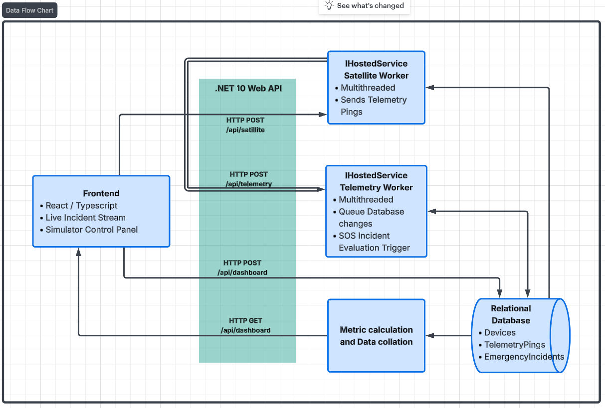
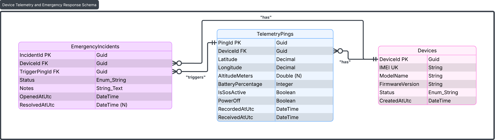
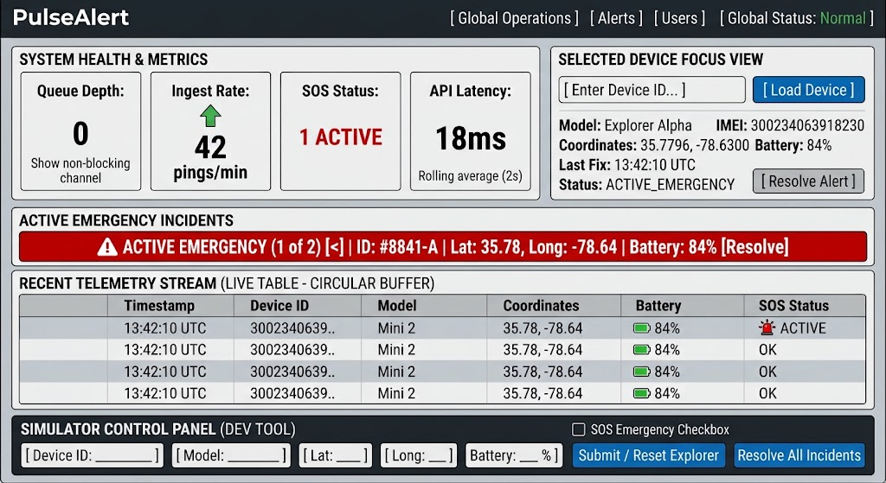

# The Plan - 🛰️ PulseAlert
This plan is to be established before any code is written, to establish clear goals and direction. The content should remain largely unchanged to illustrate the ideas that existed before any issues of implementation arose. 

## 🎯 Vision & Goals
A server and dashboard for tracking GPS devices and responding to SOS signals. 

This project is inspired by Garmin inReach. This service can be critical preparation for outdoorsmen, explorers, and anyone who seeks to go into the untamed wild with a layer of protection from the tamed home. 

The idea is that explorers have devices which contain a GPS tracker, and some kind of SOS button. The device turns on, and it sends location data to a tracking service until the device turns off. In case of an emergency, the explorer can use the SOS button, which alerts the tracking service to an emergency. The tracking service can then call proper authorities to send assistance. 

The tracking service stores the location data on a server, where it can easily be monitored from a dashboard. When an SOS signal is sent, the dashboard alerts the user, who can then take proper action. 

### Core Components 
The project should consist of the following components: 
* A Backend Receiver and Processor: This service will receive incoming satellite-relayed messages. It will feature message validation, and SOS processing. It should be able to handle a large amount of incoming signals without impeding other functionality. 
* A Frontend Monitoring Dashboard: This React app will show the satellite-relayed messages on a convenient dashboard. In case of an emergency, it should provide response options. 
* A Relational Database: This will record satellite-relayed messages, devices, and ongoing emergencies. 
* Cloud platform hosting: The backend and database must be hosted, and operate on a cloud platform. This cloud platform should be configured using Tarraform.

The project would need a number of GPS devices signaling to the receiver, but that is unrealistic. Instead a microservice, run by the backend will simulate these signals. 

### 🚫 Out of Scope and Practical Limitations
* Actual functionality of the dashboard is limited. Responding to an emergency should be limited to pressing a "Resolve" button. 
* Realistic GPS locations are of no concern. 
* A realistic system would work over a long time span, and process tens of thousands of signals per hour. For demonstration purposes this system will process much fewer signals and over a shorter period of time. 
* The project will not attempt to interact with actual satellites. The project scope assumes that satellite messages are delivered to the server via a webhook. 
* The project assumes that the technology supporting the app will be stable and functional. 

## 🛠️ Architecture & Tech Stack
### System Architecture

### Backend Server
* The backend framework will be .NET 10 and an ASP.NET Core Web API.
* Real time web functionality will be done through SignalR. 

#### Satellite Worker
The worker is a hosted service running in the background of the app. It simulates a number of explorers, using devices out in the world. Each explorer has a location, speed, battery life, SOS state, and flags to dictate behavior. The explorer will move around, while decreasing their battery life. There will be two things the explorer can do: 
* Deactivate their device, indicating the end of an adventure and no more need of service. 
* Send an SOS, indicating the need for assistance. 
Both of these actions are communicated via a HTTP webhook in the API. 

#### API
The API will use system threading to asynchronously handle incoming requests. 

#### Signal Processing and SOS Evaluation
When a signal is received it is first added to the TelemetryPings table, and if the device is unknown, it is also added to the Devices table. Signal Processing checks for two situations: If an Emergency Incident needs to be created and if a device needs to be activated or deactivated. 

When a device reports telemetry data, a device is set to active. This indicates that the device has been turned on, and the explorer is on their way. Devices need to be deactivated in order to indicate that the explorer no longer needs service. 

If a signal comes in reporting an SOS. This indicates that the device user has asked for help. If a signal comes in reporting an SOS, the system first checks if there is already an Emergency Incident in progress. If not, it creates a new incident. It is important to note that if a signal comes in, not reporting an SOS, while an active Emergency Incident exists, the incident is not affected. Users cannot "undo" an SOS signal, in the same way they can't un-call 911 or un-pull a fire alarm. 

If an Incident is created, the proper entry is added to the database table and the UI is immediately updated. Note that incidents are only resolved via a button on the dashboard. 

Since signals arrive asynchronously, signal processing also has to be asychronous. Signal processing is done by a Telemetry Worker. When the worker needs to touch the database it enters a thread safe queue which organizes threads when accessing the database. 

### Database
Entity Relationship Diagram (ERD)

* The database will be made in PostgreSQL and managed with Entity Framework Core.

#### Devices Table
| Column Name | Data Type | Constraints / Attributes | Description |
| :--- | :--- | :--- | :--- |
| **DeviceId** | Guid | Primary Key, Non-null | Unique internal identifier for the device. |
| **IMEI** | String | Unique Index, Max length: 15 | International Mobile Equipment Identity used for satellite network routing. |
| **ModelName** | String | Max length: 100 | Hardware model name (e.g., inReach Mini 2). |
| **FirmwareVersion** | String | Max length: 50 | Active software version on the physical unit. |
| **Status** | String | Max length: 20 | Operating status (Active, Deactivated). |
| **CreatedAtUtc** | DateTime | Non-null | UTC timestamp when the device was registered. |

#### TelemetryPings Table
| Column Name | Data Type | Constraints / Attributes | Description |
| :--- | :--- | :--- | :--- |
| **PingId** | Guid | Primary Key, Non-null | Unique identifier for the telemetry entry. |
| **DeviceId** | Guid | Foreign Key (Devices.DeviceId) | Reference to the associated hardware device. |
| **Latitude** | Decimal | Precision (9,6) | Latitude geographic coordinate (-90.000000 to 90.000000). |
| **Longitude** | Decimal | Precision (9,6) | Longitude geographic coordinate (-180.000000 to 180.000000). |
| **AltitudeMeters** | Double | Nullable | Elevation above sea level in meters. |
| **BatteryPercentage** | Integer | Range (0–100) | Remaining battery percentage reported by the device. |
| **IsSosActive** | Boolean | Non-null | Flag indicating whether the ping was sent during an active emergency. |
| **PowerOff** | Boolean | Non-null | Flag indicating whether the device is being turned off. |
| **RecordedAtUtc** | DateTime | Non-null | UTC timestamp generated by the device's GPS hardware. |
| **ReceivedAtUtc** | DateTime | Non-null | UTC timestamp recorded when the server processed the request. |

#### EmergencyIncidents Table
| Column Name | Data Type | Constraints / Attributes | Description |
| :--- | :--- | :--- | :--- |
| **IncidentId** | Guid | Primary Key, Non-null | Unique identifier for the emergency ticket. |
| **DeviceId** | Guid | Foreign Key (Devices.DeviceId) | Hardware unit associated with the emergency alert. |
| **TriggerPingId** | Guid | Foreign Key (TelemetryPings.PingId) | Telemetry ping that originally initiated the alert. |
| **Status** | String | Max length: 30 | Lifecycle state (Active, Resolved). |
| **Notes** | String | Text / Unlimited | Operator logs and dispatch notes recorded during response coordination. |
| **OpenedAtUtc** | DateTime | Non-null | UTC timestamp when the emergency was registered. |
| **ResolvedAtUtc** | DateTime | Nullable | UTC timestamp when the incident was marked resolved. | 

* Should have a Postgres partial unique index allowing for only one non-resolved incident per DeviceId 

### Frontend Dashboard
Entity Relationship Diagram (ERD)

* The frontend is written in React and uses TypeScript for type safety. 
* State management and data fetching will be done with React Query. 

#### Header & Branding Bar
The top bar running across the dashboard. Establishes application branding (PulseAlert) and displays global navigation or quick status indicators.

#### System Health & Metrics Panel (Top-Left)
Displays metrics of real-time system performance. It includes: 
* Queue Depth: Shows how many incoming pings are currently waiting in the .NET background queue.
* Ingest Rate: Measures the throughput (e.g., pings per minute) being processed by the backend.
* SOS Status: Shows the current total count of active emergency alerts requiring operator intervention.
* API Latency: Displays the round-trip response time (in milliseconds) of HTTP requests to track backend responsiveness.

#### Selected Device Focus View (Top-Right)
A dedicated inspector panel for deep telemetry inspection of a specific device. At the top is a text box and button for setting the panel to display a specific Device ID. Alternatively the panel can be set by clicking any row of the Telemetry Stream or the Active Emergency Incidents Banner. The panel shows model, IMEI number, exact coordinates, last signal timestamp, battery life, and current status. It also includes a button to Resolve an active alert, if applicable.

If a map is added, it will be here. 

#### Active Emergency Incidents Banner
A high-visibility alert bar highlighted in red, displaying data of an active Emergency Incident. It displays critical high-level information (Device ID, latest coordinates, battery). It also has a button to Resolve the incident. At the top it has navigation arrows to view other active emergencies. Clicking the bar loads the Device of the current emergency into the Focus View. 

#### Recent Telemetry Stream (Live Table)
A real-time table displaying incoming telemetry fixes. Lists recent GPS updates (Timestamp, Device ID, Model, Coordinates, Battery %, and SOS Status). To keep the browser DOM performant under high-frequency data streams, it operates as a circular buffer (showing only the top ~20–25 most recent pings).

#### Simulator Control Panel
A developer/demo tool to allow for testing the life cycle of a single Explorer/Device. Operators can input a Device ID, Device Model, latitude/longitude coordinates, battery %, and an SOS emergency checkbox and then click a button. This creates a new Explorer or resets an existing Explorer, if the Device ID has already been used. The Explorer acts normally; however, if the SOS emergency checkbox has been checked, they will soon trigger an SOS emergency. 

This panel also includes a "Resolve All Incidents" button, which resolves all current emergency incidents. 

### DevOps & Cloud Infrastructure
* Terraform will be used to provision cloud resources.
* Hosting will be done on Azure. 
* Docker will be used to containerize the .NET backend and web server for local development and deployment. 
* GitHub Actions will be used for builds, tests, and automated code quality checks.

### Quality & Testing
* xUnit & Moq will be used for Unit testing of .NET business logic and alert handlers.
* React Testing Library will be used for Unit and UI component testing.

## 🗺️ Roadmap
* Phase 0: Planning
  * **Goal:** Flesh out idea as much as possible 
  * Establish project scope
  * Write PLAN.md
  * Create visuals
  * Write clear instructions
* Phase 1: Architecture & Data Model
  * **Goal:** Establish the C# solution and database schema.
  * Scaffold .NET 10 Web API Solution:
    * Create a clean layer structure: Core (domain models/interfaces), Infrastructure (EF Core/DB context), API (controllers/endpoints).
  * Design EF Core Data Model:
    * Device: Device ID, model, status.
    * TelemetryPing: GPS coordinates (lat/long/altitude), battery level, timestamp.
    * EmergencyIncident: Status (Active, Resolved), timestamp.
  * Database Setup:
    * Configure EF Core migrations with PostgreSQL.
* Phase 2: Ingestion Pipeline & Background Processing
  * **Goal:** Build the engine that simulates and processes incoming satellite data.
  * Satellite Ingestion Endpoint:
    * Build a POST /api/telemetry controller endpoint that accepts incoming GPS pings.
  * Channel / In-Memory Queue:
    * Use .NET System.Threading.Channels to handle incoming pings asynchronously without blocking HTTP requests.
  * Background Worker (IHostedService):
    * Write a background worker service that reads pings off the channel and writes them to the database in bulk using EF Core.
  * Emergency Trigger Logic:
    * If an incoming ping has SOS_Active = true, auto-create or update an EmergencyIncident record.
* Phase 3: Simple Monitoring Endpoint / Dashboard
  * **Goal:** Provide visibility into system metrics.
  * API Telemetry Status Endpoint:
    * GET /api/dashboard: Returns total pings processed per minute, queue depth, and active SOS count.
  * Lightweight React / TypeScript Front End:
    * A 1-page dashboard using React and TypeScript displaying:
      * Live metrics counters 
      * A detailed device view 
      * A list of active emergencies 
      * A live stream of incomming telemetry pings 
      * A demo control panel
* Phase 4: Infrastructure as Code (Terraform)
  * **Goal:** Use Terraform in order to manage a cloud deployment.
  * Create terraform/ Directory:
    * Write a modular main.tf file that provisions:
      * An Azure PostgreSQL instance.
      * An Azure App Runner hosting the .NET API.
    * Local Validation:
      * Ensure terraform plan runs successfully against local environment variables.
* Phase 5: Testing, Documentation & Polish
  * **Goal:** Packaging for interview discussion.
  * Unit Tests:
    * Add a few xUnit tests covering the ingestion service logic and validation handlers.
  * Comprehensive README.md:
    * Write a clear overview explaining:
      * Decisions made.
      * Instructions to run locally via dotnet run.
* Phase 6: Leaving the Project Scope
  * **Goal:** Implement stretch goals
  * Front End Map - A map on the device focus view to see where the device is.
  * Deadman's Switch - A background process which creates an emergency if a device suddenly stops sending pings. 
  * A More Impressive Explorer - Something with more meaningful locations and more interesting behaviors. 
  * Crash Resistance and Recovery - Making the system more stable in case of platform instability. 
  * Simple Validation - Checking for corrupted data or duplicate pings. 
  * A more interesting incident resolution process 
